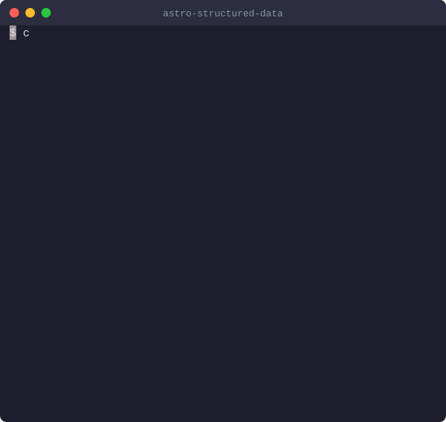

# @casoon/astro-structured-data

Structured data for Astro, from the content you already have.

Search engines read [schema.org](https://schema.org) JSON-LD to understand a page and to show it as a rich result: an article with its date and image, a product with price and stock, an event with its date and venue, a job with salary and location. This integration turns your page data into that JSON-LD and the matching meta tags, and stops the build when the data would not be valid.

[](https://www.npmjs.com/package/@casoon/astro-structured-data)
[](https://astro.build/)
[](LICENSE)

**Website and documentation:** [casoon.github.io/astro-structured-data](https://casoon.github.io/astro-structured-data/) · [npm](https://www.npmjs.com/package/@casoon/astro-structured-data) · [Product page](https://astro-structured-data.casoon.de/)

<p align="center">
  
</p>
<p align="center"><sub>Recorded from real builds of the sample project in <a href="site/captures/"><code>site/captures/</code></a>.</sub></p>

## Why

- **Rich results need structured data.** Prices, ratings, event dates, recipe times or job details only appear in search results when the page describes them as schema.org data, in the form Google and other search engines expect.
- **Hand-written JSON-LD fails silently.** A date in the wrong format, a currency symbol instead of a code or a missing required field produces no error. The markup is simply not used, and you find out weeks later in Search Console, if at all.
- **Your pages already have the data.** Titles, dates, prices and addresses sit in frontmatter, content collections or your CMS. Pass them as props instead of maintaining a second copy as JSON.
- **Checked where you can fix it.** Every component validates its props at build time. Wrong data stops the build with the component, the page and the field, so it never reaches production.

## What you get

For this component on a blog post:

```astro
<ArticleSchema
  title="Hello, Astro"
  description="Our first post."
  datePublished="2026-10-01"
  authorName="Ada Lovelace"
  imageUrl="/img/hello.jpg"
  publisherName="Example Blog"
/>
```

the build writes the JSON-LD into the page:

```json
{
  "@context": "https://schema.org",
  "@type": "BlogPosting",
  "headline": "Hello, Astro",
  "description": "Our first post.",
  "datePublished": "2026-10-01",
  "dateModified": "2026-10-01",
  "mainEntityOfPage": { "@type": "WebPage", "@id": "https://example.com/blog/hello-astro/" },
  "author": { "@type": "Person", "name": "Ada Lovelace" },
  "isAccessibleForFree": true,
  "publisher": { "@type": "Organization", "name": "Example Blog" },
  "image": { "@type": "ImageObject", "url": "/img/hello.jpg" }
}
```

and, with `generateMeta: true`, the matching tags into `<head>`:

```html
<link rel="canonical" href="https://example.com/blog/hello-astro/">
<meta name="description" content="Our first post.">
<meta name="author" content="Ada Lovelace">
<meta property="og:title" content="Hello, Astro">
<meta property="og:description" content="Our first post.">
<meta property="og:url" content="https://example.com/blog/hello-astro/">
<meta property="og:image" content="https://example.com/img/hello.jpg">
<meta property="og:site_name" content="Example Blog">
<meta property="og:type" content="article">
<meta property="article:published_time" content="2026-10-01">
<meta property="article:modified_time" content="2026-10-01">
<meta name="twitter:title" content="Hello, Astro">
<meta name="twitter:description" content="Our first post.">
<meta name="twitter:image" content="https://example.com/img/hello.jpg">
<meta name="twitter:card" content="summary_large_image">
```

Beyond that:

- **One `@graph` per page** if you prefer: with `useGraph: true`, all schemas of a page are merged into a single block, wherever the components sit.
- **A build report:** after `astro build`, every JSON-LD block is checked, and missing recommended fields are listed per type.
- **A Dev Toolbar panel** in `astro dev` that previews each schema of the page as a rich result and lists what is missing.
- **Zod schemas** for your content collections and forms, the same ones the components use.
- **Sitemap hints** (`changefreq`, `priority`) on the JSON-LD script for post-build sitemap generators.
- **No client JavaScript.** Everything happens at build time (or on the server in SSR).

## Quick start

```bash
npm install @casoon/astro-structured-data
```

```js
// astro.config.mjs
import { defineConfig } from 'astro/config';
import structuredData from '@casoon/astro-structured-data';

export default defineConfig({
  site: 'https://example.com', // or pass siteUrl to the integration
  integrations: [
    structuredData({
      generateMeta: true,
      siteName: 'Example Blog',
      locale: 'en_US',
    }),
  ],
});
```

Then put a component on a page or layout and pass the data you already have:

```astro
---
// src/layouts/Post.astro
import { ArticleSchema } from '@casoon/astro-structured-data/components';
const { post } = Astro.props;
---
<ArticleSchema
  title={post.data.title}
  description={post.data.description}
  datePublished={post.data.date}
  authorName={post.data.author}
  imageUrl={post.data.cover}
/>
```

Run `astro build`. Wrong data stops the build, missing recommended fields are listed.

## Examples by kind of site

### Blog or magazine

The site and the publisher once in the base layout, the article and its breadcrumb trail on each post. The reading time can be computed from the post itself.

```js
// astro.config.mjs
structuredData({
  generateMeta: true,
  defaultArticlePublisher: { name: 'Example Blog', logo: { url: 'https://example.com/logo.png' } },
})
```

```astro
---
// src/layouts/Base.astro
import { OrganizationSchema, WebSiteSchema } from '@casoon/astro-structured-data/components';
---
<WebSiteSchema name="Example Blog" />
<OrganizationSchema sameAs={['https://mastodon.social/@example']} />
```

```astro
---
// src/layouts/Post.astro
import { ArticleSchema, AutoBreadcrumbSchema } from '@casoon/astro-structured-data/components';
import { calculateReadingTime } from '@casoon/astro-structured-data/utils';
const { post } = Astro.props;
const { wordCount, readingTimeMinutes } = calculateReadingTime(post.body);
---
<ArticleSchema
  title={post.data.title}
  description={post.data.description}
  datePublished={post.data.date}
  authorName={post.data.author}
  imageUrl={post.data.cover}
  keywords={post.data.tags}
  wordCount={wordCount}
  readingTimeMinutes={readingTimeMinutes}
/>
<AutoBreadcrumbSchema labels={{ blog: 'Blog' }} />
```

`OrganizationSchema` and `ArticleSchema` take the publisher from `defaultArticlePublisher`; `AutoBreadcrumbSchema` builds the trail from the URL path.

### Shop

Brand, shipping and returns usually apply to the whole shop: set them once, and every `ProductSchema` adds them to its offer.

```js
// astro.config.mjs
structuredData({
  generateMeta: true,
  defaultBrand: 'Gadget Co',
  defaultShippingDetails: {
    shippingRate: { value: 4.95, currency: 'EUR' },
    shippingDestination: { addressCountry: 'DE' },
    deliveryTime: {
      handlingTime: { minValue: 0, maxValue: 1, unitCode: 'DAY' },
      transitTime: { minValue: 1, maxValue: 3, unitCode: 'DAY' },
    },
  },
  defaultReturnPolicy: {
    applicableCountry: 'DE',
    returnPolicyCategory: 'MerchantReturnFiniteReturnWindow',
    merchantReturnDays: 30,
    returnMethod: 'ReturnByMail',
    returnFees: 'FreeReturn',
  },
})
```

```astro
<ProductSchema
  name="Super Gadget"
  description="The best gadget ever"
  imageUrl="/images/gadget.jpg"
  price={29.99}
  priceCurrency="EUR"
  availability="InStock"
  sku="SG-001"
  ratingValue={4.5}
  reviewCount={128}
/>
```

For several offers, sale prices or per-offer shipping, pass `offers` instead of `price`; for a price range across variants, `priceRange`. Category pages use `CollectionPageSchema`.

### Local business

The business data lives in the configuration and is reused wherever `<LocalBusinessSchema />` appears, typically in the base layout.

```js
// astro.config.mjs
structuredData({
  defaultLocalBusiness: {
    name: 'My Shop',
    telephone: '+49 30 1234567',
    address: { streetAddress: 'Hauptstraße 42', addressLocality: 'Berlin', postalCode: '10119', addressCountry: 'DE' },
    geo: { latitude: 52.53, longitude: 13.41 },
    openingHours: ['Mo-Fr 09:00-18:00', 'Sa 10:00-16:00'],
  },
})
```

```astro
<LocalBusinessSchema />
```

Props on a page override the defaults, e.g. a different `telephone` for a branch.

### Events

Venue, online stream or both, chosen with `attendanceMode`. An online event outputs its stream URL as a `VirtualLocation`:

```astro
<EventSchema
  name="Astro Live Webinar"
  description="Structured data in Astro, live with Q&A."
  startDate="2026-10-20T17:00:00+02:00"
  endDate="2026-10-20T18:30:00+02:00"
  attendanceMode="Online"
  onlineUrl="https://example.com/live"
  organizer={{ name: 'Example GmbH', url: 'https://example.com' }}
  price={0}
  priceCurrency="EUR"
/>
```

### Job postings

On-site jobs take a `jobLocation` address; fully remote positions say where applicants may live:

```astro
<JobPostingSchema
  title="Remote Frontend Engineer"
  description="<p>Fully remote position open worldwide.</p>"
  hiringOrganizationName="ACME GmbH"
  datePosted="2026-09-01"
  validThrough="2026-12-31"
  jobLocationType="TELECOMMUTE"
  applicantLocationRequirements="DE"
  employmentType="FULL_TIME"
  baseSalary={{ value: 72000, currency: 'EUR', unit: 'YEAR' }}
/>
```

### Content collections

Validate frontmatter with the schemas the components use, so wrong data is reported where it is written:

```ts
// src/content.config.ts
import { defineCollection } from 'astro:content';
import { glob } from 'astro/loaders';
import { eventZodSchema } from '@casoon/astro-structured-data/zod';

const events = defineCollection({
  loader: glob({ pattern: '**/*.md', base: './src/content/events' }),
  schema: eventZodSchema,
});

export const collections = { events };
```

Every example in the [showcase](https://casoon.github.io/astro-structured-data/showcase/) shows the component next to the JSON-LD it produced while the site was built.

## Configuration

| Option | Type | Default | Description |
|---|---|---|---|
| `siteUrl` | `string` | — | Absolute http(s) base URL — falls back to Astro's `site` config; one of the two is required |
| `useGraph` | `boolean` | `false` | Combine all schemas of a page into one `@graph` block (requires `<SchemaGraph />` in the layout) |
| `generateMeta` | `boolean` | `false` | Generate head meta tags (canonical, `og:*`, `twitter:*`, …) from the schemas |
| `siteName` | `string` | — | Site name for `og:site_name` |
| `locale` | `string` | — | Locale for `og:locale` (e.g. `de_DE`) |
| `twitterSite` | `string` | — | Twitter handle for `twitter:site` (e.g. `@my_site`) |
| `twitterCreator` | `string` | — | Fallback handle for `twitter:creator` (e.g. `@author`) |
| `warnOnMissingRecommended` | `boolean` | `true` | List missing recommended schema.org fields after the build |
| `defaultLocalBusiness` | `LocalBusinessSchema` props | — | Business data used by `LocalBusinessSchema` |
| `defaultArticlePublisher` | `{ name: string; logo?: { url: string }; id?: string }` | — | Publisher for `ArticleSchema`, `WebPageSchema`, `OrganizationSchema` and the hiring organization of `JobPostingSchema`; `id` is emitted as `@id` wherever this default is used |
| `defaultBrand` | `Brand \| string` | — | Brand for `ProductSchema` |
| `defaultShippingDetails` | `OfferShippingDetails` | — | Shipping details for `ProductSchema` offers |
| `defaultReturnPolicy` | `MerchantReturnPolicy` | — | Return policy for `ProductSchema` offers |

Options are validated when the integration is created; unknown keys and invalid values fail the build.

The integration adds a middleware that completes every HTML page once it has rendered: it inserts the `@graph` block (graph mode) and the meta tags (`generateMeta`). Because it needs the complete page, HTML responses are buffered instead of streamed.

## Validation

Every component validates its props against its Zod schema when the page renders. Invalid data throws and fails the build (or the request, in SSR) with the component, the page and the offending fields:

```
[astro-structured-data] <EventSchema> on /events/meetup/ received invalid props:
✖ Must be an ISO 4217 currency code like "EUR"
  → at priceCurrency
```

- **Unknown props are errors**, so a typo cannot drop data. Astro's own attributes (`slot`, `data-astro-*`) are ignored.
- **Formats:** dates are ISO 8601 (`2026-06-01`, `2026-06-01T18:00:00+02:00`) or `Date` objects; durations ISO 8601 (`PT1H30M`); currencies ISO 4217 (`EUR`); country codes ISO 3166 (`DE`); URLs absolute `http(s)` or root-relative (`/img.jpg`); text must not be empty.
- **Rules across fields**, e.g. `price` only with `priceCurrency`, `ratingValue` only with `reviewCount`, image dimensions only with an image, an end date not before its start date, an online event with a stream URL.
- **schema.org objects** such as offers, brand, shipping details and return policies are checked for their known properties, including schema.org enumeration values (`InStock` or `https://schema.org/InStock`). Nested types such as `MonetaryAmount` are added to the output when you leave them out; further schema.org properties pass through.
- **No invented values:** where schema.org needs a value, such as an organization name, it comes from a prop or a configured default.
- **Page level:** all schemas of a page agree on their sitemap hints; in graph mode the page renders `<SchemaGraph />` exactly once.

The exported Zod schemas ignore unknown top-level keys, so they work for frontmatter with additional fields; the components themselves are strict. The generic [`<Schema>`](#schema) component outputs its object as given.

## Meta tags

With `generateMeta: true`, the middleware derives `<meta>` and `<link>` elements from the schemas of the page and inserts them at the end of `<head>`. It runs after the page has rendered, so it sees every schema, wherever the components sit.

- **Content tags** (title, description, image, `og:type`) come from the most page-specific schema: Article types, Product, Recipe, VideoObject, Event, JobPosting, SoftwareApplication, ProfilePage, FAQPage, WebPage — before site-wide LocalBusiness and WebSite schemas.
- **Page tags** (`robots`, `hreflang` alternates, canonical URL) come from `WebPageSchema` and its variants, so a `noindex` page with an article on it stays `noindex`.
- **Your tags win:** tags the layout already sets (same `name`/`property`, canonical, `hreflang`) are kept. A canonical link you set yourself is also used for `og:url`; an `og:image` you set yourself comes without the schema image's details.
- **Canonical URL:** built from `siteUrl` and the page path, or taken from a `WebPageSchema` `url` or an article's `mainEntityOfPage`.

Generated tags:

* **Canonical:** `<link rel="canonical" href="...">`
* **Description, robots, author** and a non-standard `reading-time`
* **Alternates:** `<link rel="alternate" hreflang="..." href="...">` from `alternates` or `workTranslation`
* **Open Graph:** `og:title`, `og:description`, `og:image` with width, height, type and alt, `og:url`, `og:type`, `og:site_name`, `og:locale`; for articles `article:published_time`, `article:modified_time`, `article:author` (profile URLs), `article:section`, `article:tag`; for videos `og:video` and `video:duration`
* **Twitter:** `twitter:card`, `twitter:title`, `twitter:description`, `twitter:image`, `twitter:image:alt`, `twitter:site`, `twitter:creator`

Relative image URLs are resolved against `siteUrl`.

### Sitemap hints

Every component, and the generic `<Schema>`, accepts `changefreq` and `priority` (e.g. `<ArticleSchema … changefreq="weekly" priority={0.8} />`). They are written as data attributes on the JSON-LD `<script>` (the `@graph` script in graph mode), not into the JSON-LD. A page has one sitemap entry, so all schemas of a page must agree. Post-build sitemap generators such as `@casoon/astro-site-files` read them from the HTML; without one they have no effect.

## Dev Toolbar

In `astro dev`, the integration adds a **Structured Data** panel to the Astro Dev Toolbar. For every JSON-LD block on the current page it shows:

- **A rich result preview** in Google's style: article with thumbnail and date, product with rating, price and stock, breadcrumb trail, event with date box and venue, job card with location, employment type and salary, local business with phone, address and hours, software app with rating, OS and category.
- **Checks per type** for required and recommended fields.
- **Copy JSON-LD**, a link to the schema.org validator, and the raw JSON.

FAQPage markup is listed with its questions; Google no longer shows FAQ rich results (since May 2026).

## Build report

After every build the integration reads every JSON-LD block in the output HTML. A block that is not valid JSON fails the build. With `warnOnMissingRecommended` (on by default) it lists each missing recommended field once per type, nested properties as dot paths:

```
[structured-data] Organization is missing recommended field "sameAs" — add it for richer search results.
```

Turn the list off with `structuredData({ warnOnMissingRecommended: false })`.

## Components

Import components from `@casoon/astro-structured-data/components`:

```astro
---
import { ArticleSchema, FAQSchema } from '@casoon/astro-structured-data/components';
---
```

---

### ArticleSchema

Docs: [schema.org/Article](https://schema.org/Article) · [Google: Article](https://developers.google.com/search/docs/appearance/structured-data/article)

```astro
<ArticleSchema
  title="My Article"
  description="Article description"
  datePublished="2024-01-01"
  authorName="Jane Doe"
  imageUrl="https://example.com/image.jpg"
/>
```

| Prop | Type | Required | Description |
|---|---|---|---|
| `id` | `string` | No | Article `@id`, so other nodes can reference it |
| `title` | `string` | Yes | Article headline |
| `description` | `string` | Yes | Article description |
| `datePublished` | `string \| Date` | Yes | Publication date |
| `dateModified` | `string \| Date` | No | Last modified date |
| `authorName` | `string \| string[]` | Yes | Author name(s) |
| `authorType` | `'Person' \| 'Organization'` | No | Default: `'Person'` |
| `authorUrl` | `string` | No | Author profile URL (single author only) |
| `authorId` | `string` | No | Author `@id` for linked data (single author only) |
| `imageUrl` | `string` | No | Article image URL |
| `imageWidth` | `number` | No | Image width in pixels |
| `imageHeight` | `number` | No | Image height in pixels |
| `imageFormat` | `string` | No | Image MIME type, e.g. `'image/jpeg'` |
| `imageCaption` | `string` | No | Image caption |
| `publisherName` | `string` | No | Publisher name (falls back to `defaultArticlePublisher`) |
| `publisherLogo` | `string` | No | Publisher logo URL (falls back to `defaultArticlePublisher`) |
| `publisherId` | `string` | No | Publisher `@id` for linked data (falls back to `defaultArticlePublisher.id` unless `publisherName` is set) |
| `schemaType` | `'Article' \| 'BlogPosting' \| 'NewsArticle'` | No | Default: `'BlogPosting'` |
| `inLanguage` | `string` | No | Content language, e.g. `'de'` |
| `articleSection` | `string` | No | Section or category name |
| `keywords` | `string \| string[]` | No | Keywords |
| `wordCount` | `number` | No | Word count |
| `readingTimeMinutes` | `number` | No | Reading time in minutes (encoded as `timeRequired`) |
| `isAccessibleForFree` | `boolean` | No | Default: `true` |
| `isPartOfHeadline` | `string` | No | Parent series headline (for `isPartOf`) |
| `isPartOfUrl` | `string` | No | Parent series URL |
| `isPartOf` | `{ type?, id?, name?, headline?, url? }` or array | No | Typed parent reference (needs `id` or `url`); instead of `isPartOfHeadline` / `isPartOfUrl` |
| `seriesPosition` | `number` | No | Position within the series |
| `hasPart` | `{ type?, id?, name?, headline?, url?, position? }[]` | No | Child articles in a series (each needs `id` or `url`) |

---

### FAQSchema

Docs: [schema.org/FAQPage](https://schema.org/FAQPage) · [Google: FAQ](https://developers.google.com/search/docs/appearance/structured-data/faqpage)

```astro
<FAQSchema
  questions={[
    { question: 'What is this?', answer: 'An Astro integration.' },
    { question: 'How does it work?', answer: 'It injects JSON-LD.' },
  ]}
/>
```

| Prop | Type | Required | Description |
|---|---|---|---|
| `id` | `string` | No | FAQ page `@id`, so other nodes can reference it |
| `questions` | `{ question: string; answer: string }[]` | Yes | List of Q&A pairs |

---

### ProductSchema

Docs: [schema.org/Product](https://schema.org/Product) · [Google: Product](https://developers.google.com/search/docs/appearance/structured-data/product)

```astro
<ProductSchema
  name="Super Gadget"
  description="The best gadget ever"
  imageUrl="https://example.com/gadget.jpg"
  price={29.99}
  priceCurrency="EUR"
  availability="InStock"
  sku="SG-001"
  ratingValue={4.5}
  reviewCount={128}
/>
```

| Prop | Type | Required | Description |
|---|---|---|---|
| `id` | `string` | No | Product `@id`, so other nodes can reference it |
| `name` | `string` | Yes | Product name |
| `description` | `string` | Yes | Product description |
| `imageUrl` | `string \| string[]` | Yes | Product image URL(s) |
| `price` | `string \| number` | No | Price (simple offer) |
| `priceCurrency` | `string` | No | ISO 4217 currency code, e.g. `'EUR'` |
| `availability` | `'InStock' \| 'OutOfStock' \| 'PreOrder' \| 'OnlineOnly'` | No | Offer availability (requires `price`) |
| `offers` | `Offer \| AggregateOffer \| (…)[]` | No | Full offer object(s) for advanced use cases; an `Offer` needs `price` + `priceCurrency` (or `priceSpecification`) |
| `priceRange` | `PriceRange` | No | Price range for variable pricing |
| `brand` | `string \| Brand` | No | Brand name or object (falls back to `defaultBrand`) |
| `sku` | `string` | No | Stock keeping unit |
| `gtin` | `string` | No | GTIN barcode |
| `ratingValue` | `number` | No | Aggregate rating (0–5), only together with `reviewCount` |
| `reviewCount` | `number` | No | Number of reviews, only together with `ratingValue` |
| `reviews` | `ReviewItem[]` | No | Individual review objects |
| `shippingDetails` | `OfferShippingDetails` | No | Shipping details (falls back to `defaultShippingDetails`) |
| `returnPolicy` | `MerchantReturnPolicy` | No | Return policy (falls back to `defaultReturnPolicy`); `MerchantReturnFiniteReturnWindow` needs `merchantReturnDays` |
| `isVariantOf` | `{ type?, id?, name?, headline?, url? }` | No | Group by `id` or `url` (default `ProductGroup`) |
| `hasVariant` | `{ type?, id?, name?, headline?, url?, position? }[]` | No | Variants by `id` or `url` |
| `isRelatedTo` | `{ type?, id?, name?, headline?, url? }` or array | No | Related products |
| `isSimilarTo` | `{ type?, id?, name?, headline?, url? }` or array | No | Similar products |
| `isAccessoryOrSparePartFor` | `{ type?, id?, name?, headline?, url? }` or array | No | Products this is an accessory or spare part for |
| `isConsumableFor` | `{ type?, id?, name?, headline?, url? }` or array | No | Products this is a consumable for |

---

### LocalBusinessSchema

Docs: [schema.org/LocalBusiness](https://schema.org/LocalBusiness) · [Google: Local Business](https://developers.google.com/search/docs/appearance/structured-data/local-business)

```astro
<LocalBusinessSchema
  name="My Shop"
  telephone="+49 30 1234567"
  address={{
    streetAddress: 'Hauptstraße 42',
    addressLocality: 'Berlin',
    postalCode: '10119',
    addressCountry: 'DE',
  }}
  openingHours={['Mo-Fr 09:00-18:00', 'Sa 10:00-16:00']}
/>
```

All props fall back to `defaultLocalBusiness` from the integration config. A `name` is required — as a prop or in the defaults.

| Prop | Type | Required | Description |
|---|---|---|---|
| `name` | `string` | Yes* | Business name (*unless `defaultLocalBusiness.name` is set) |
| `id` | `string` | No | `@id` for linked data (falls back to `defaultLocalBusiness.id` unless `name` is set) |
| `url` | `string` | No | Business website URL |
| `description` | `string` | No | Short business description |
| `imageUrl` | `string` | No | Business image URL |
| `telephone` | `string` | No | Phone number |
| `email` | `string` | No | Email address |
| `priceRange` | `string` | No | Price range indicator, e.g. `'$$'` |
| `address` | `{ streetAddress, addressLocality, addressRegion?, postalCode, addressCountry }` | No | Postal address |
| `geo` | `{ latitude: number; longitude: number }` | No | Geographic coordinates |
| `openingHours` | `string[]` | No | Opening hours, e.g. `['Mo-Fr 09:00-18:00']` |
| `sameAs` | `string[]` | No | Social profile / same-entity URLs (e.g. Google Business, Facebook) |
| `parentOrganization` | `{ type?, id?, name?, headline?, url? }` | No | Parent by `id` or `url` (default `Organization`) |
| `subOrganization` | `{ type?, id?, name?, headline?, url? }` or array | No | Sub-organizations |

---

### BreadcrumbSchema

Docs: [schema.org/BreadcrumbList](https://schema.org/BreadcrumbList) · [Google: Breadcrumb](https://developers.google.com/search/docs/appearance/structured-data/breadcrumb)

```astro
<BreadcrumbSchema
  items={[
    { name: 'Home', url: '/' },
    { name: 'Blog', url: '/blog' },
    { name: 'My Post', url: '/blog/my-post' },
  ]}
/>
```

| Prop | Type | Required | Description |
|---|---|---|---|
| `id` | `string` | No | BreadcrumbList `@id`, so other nodes can reference it |
| `items` | `{ name: string; url: string }[]` | Yes | Ordered breadcrumb items |

---

### AutoBreadcrumbSchema

Docs: [schema.org/BreadcrumbList](https://schema.org/BreadcrumbList) · [Google: Breadcrumb](https://developers.google.com/search/docs/appearance/structured-data/breadcrumb)

Generates breadcrumbs automatically from the current URL path. Segments are converted from kebab-case to title case by default. Percent-encoded segments are decoded for names, `labels` and `ignoreSegments` (`/%C3%BCber-uns/` → `labels={{ 'über-uns': 'Über uns' }}`); the URLs keep the path as it is.

```astro
<AutoBreadcrumbSchema />

<!-- With custom labels -->
<AutoBreadcrumbSchema
  homeLabel="Start"
  labels={{ blog: 'Articles', 'my-post': 'My Post' }}
/>
```

| Prop | Type | Required | Description |
|---|---|---|---|
| `homeLabel` | `string` | No | Label for the root segment. Default: `'Home'` |
| `labels` | `Record<string, string>` | No | Override labels for specific URL path segments |
| `ignoreSegments` | `string[]` | No | URL segments to skip — useful for language prefixes like `['de', 'en']` |
| `prependBreadcrumbs` | `{ name: string; url: string }[]` | No | Breadcrumbs inserted after Home, before auto-generated segments |
| `appendBreadcrumbs` | `{ name: string; url: string }[]` | No | Breadcrumbs appended after all auto-generated segments |

---

### EventSchema

Docs: [schema.org/Event](https://schema.org/Event) · [Google: Event](https://developers.google.com/search/docs/appearance/structured-data/event)

```astro
<EventSchema
  name="Tech Meetup Berlin"
  startDate="2024-06-15T18:00:00"
  locationName="Hub Berlin"
  locationAddress={{
    streetAddress: 'Alexanderplatz 1',
    addressLocality: 'Berlin',
    postalCode: '10178',
    addressCountry: 'DE',
  }}
  attendanceMode="Offline"
  status="Scheduled"
/>

<!-- Online event: no venue, the stream URL becomes a VirtualLocation -->
<EventSchema
  name="Astro Live Webinar"
  startDate="2024-06-20T17:00:00+02:00"
  attendanceMode="Online"
  onlineUrl="https://example.com/live"
/>
```

The location follows the `attendanceMode`, as Google requires: `'Offline'` needs `locationName` + `locationAddress` (output as `Place`), `'Online'` needs `onlineUrl` and allows no venue (output as `VirtualLocation`), `'Mixed'` needs both (output as `[Place, VirtualLocation]`). Any other combination fails the build.

| Prop | Type | Required | Description |
|---|---|---|---|
| `id` | `string` | No | Event `@id`, so other nodes can reference it |
| `name` | `string` | Yes | Event name |
| `startDate` | `string \| Date` | Yes | Start date/time |
| `endDate` | `string \| Date` | No | End date/time |
| `description` | `string` | No | Event description |
| `imageUrl` | `string \| string[]` | No | Event image URL(s) |
| `locationName` | `string` | Offline/Mixed | Venue name |
| `locationAddress` | `{ streetAddress, addressLocality, addressRegion?, postalCode, addressCountry }` | Offline/Mixed | Venue address |
| `onlineUrl` | `string` | Online/Mixed | Absolute http(s) URL of the stream or virtual event (output as `VirtualLocation`) |
| `attendanceMode` | `'Offline' \| 'Online' \| 'Mixed'` | No | Default: `'Offline'` |
| `status` | `'Scheduled' \| 'Cancelled' \| 'Postponed' \| 'Rescheduled'` | No | Default: `'Scheduled'` |
| `url` | `string` | No | Event page URL |
| `price` | `number \| string` | No | Ticket price |
| `priceCurrency` | `string` | No | ISO 4217 currency code |
| `availability` | `'InStock' \| 'OutOfStock' \| 'PreOrder' \| 'OnlineOnly'` | No | Ticket availability |
| `organizer` | `{ name: string; url?: string; id?: string }` | No | Organizing entity (recommended by Google); `id` is output as `@id` |
| `performer` | `{ name: string; url?: string; id?: string }` | No | Performer or speaker at the event; `id` is output as `@id` |
| `superEvent` | `{ type?, id?, name?, headline?, url? }` | No | Parent event by `id` or `url` |
| `subEvent` | `{ type?, id?, name?, headline?, url?, position? }[]` | No | Sub-events by `id` or `url` |

---

### OrganizationSchema

Docs: [schema.org/Organization](https://schema.org/Organization) · [Google: Organization](https://developers.google.com/search/docs/appearance/structured-data/organization)

```astro
<OrganizationSchema
  name="ACME Corp"
  logoUrl="https://example.com/logo.png"
  sameAs={['https://twitter.com/acme', 'https://linkedin.com/company/acme']}
/>
```

| Prop | Type | Required | Description |
|---|---|---|---|
| `name` | `string` | Yes* | Organization name (*unless `defaultArticlePublisher.name` is set) |
| `id` | `string` | No | `@id` for linked data, e.g. `'https://example.com/#organization'` (falls back to `defaultArticlePublisher.id` unless `name` is set) |
| `url` | `string` | No | Organization URL (falls back to `siteUrl`) |
| `logoUrl` | `string` | No | Logo URL (falls back to `defaultArticlePublisher.logo`; omitted if neither is set) |
| `sameAs` | `string[]` | No | Social profile / same-entity URLs |
| `telephone` | `string` | No | Phone number |
| `email` | `string` | No | Email address |
| `address` | `{ streetAddress, addressLocality, addressRegion?, postalCode, addressCountry }` | No | Postal address |
| `parentOrganization` | `{ type?, id?, name?, headline?, url? }` | No | Parent by `id` or `url` (default `Organization`) |
| `subOrganization` | `{ type?, id?, name?, headline?, url? }` or array | No | Sub-organizations |

---

### WebSiteSchema

Docs: [schema.org/WebSite](https://schema.org/WebSite) · [Google: Sitelinks Searchbox](https://developers.google.com/search/docs/appearance/structured-data/sitelinks-searchbox)

```astro
<WebSiteSchema name="My Site" />

<!-- With Sitelinks Searchbox -->
<WebSiteSchema name="My Site" searchQueryInput="q" />
```

| Prop | Type | Required | Description |
|---|---|---|---|
| `name` | `string` | Yes | Site name |
| `url` | `string` | No | Site URL (falls back to `siteUrl`) |
| `id` | `string` | No | `@id` for linked data, e.g. `'https://example.com/#website'` |
| `searchQueryInput` | `string` | No | URL query param name to enable Sitelinks Searchbox, e.g. `'q'` |

---

### WebPageSchema

Docs: [schema.org/WebPage](https://schema.org/WebPage) · [Google: WebPage](https://developers.google.com/search/docs/appearance/structured-data/webpage)

Generic page schema — use for landing pages, legal pages, or any page that doesn't fit a more specific type.

```astro
<WebPageSchema
  title="About Us"
  description="Learn more about our company."
  inLanguage="en"
  dateModified="2024-06-01"
/>
```

| Prop | Type | Required | Description |
|---|---|---|---|
| `title` | `string` | Yes | Page title |
| `description` | `string` | No | Page description |
| `url` | `string` | No | Canonical URL (falls back to current page URL); also the page's `@id`, which `ArticleSchema` references as `mainEntityOfPage` |
| `inLanguage` | `string` | No | Content language, e.g. `'de'` |
| `datePublished` | `string \| Date` | No | Publication date |
| `dateModified` | `string \| Date` | No | Last modified date |
| `isAccessibleForFree` | `boolean` | No | Default: `true` |
| `image` | `string` | No | Page image URL |
| `imageWidth` | `number` | No | Image width in pixels |
| `imageHeight` | `number` | No | Image height in pixels |
| `imageFormat` | `string` | No | Image MIME type |
| `imageCaption` | `string` | No | Image caption |
| `author` | `{ name: string; url?: string; id?: string; type?: 'Person' \| 'Organization' }` | No | Page author |
| `publisher` | `{ name: string; url?: string; logo?: string; id?: string }` | No | Publisher (falls back to `defaultArticlePublisher`, including its `id`) |
| `robots` | `string` | No | Robots directive, e.g. `'noindex'` (meta tag only, not part of the JSON-LD) |
| `alternates` | `{ href: string; hreflang: string }[]` | No | Alternate language versions (hreflang links only, not part of the JSON-LD) |
| `isPartOf` | `{ type?, id?, name?, headline?, url? }` or array | No | Parent by `id` or `url` (free `type`, default `WebSite` on WebPage, else `CreativeWork`) |
| `hasPart` | `{ type?, id?, name?, headline?, url?, position? }[]` | No | Parts by `id` or `url` |

---

### ProfilePageSchema

Docs: [schema.org/ProfilePage](https://schema.org/ProfilePage) · [Google: Profile Page](https://developers.google.com/search/docs/appearance/structured-data/profile-page)

```astro
<ProfilePageSchema
  name="Jane Doe"
  description="Software engineer and writer"
  imageUrl="https://example.com/jane.jpg"
  sameAs={['https://github.com/janedoe']}
/>
```

| Prop | Type | Required | Description |
|---|---|---|---|
| `name` | `string` | Yes | Person name |
| `id` | `string` | No | `@id` of the person, the target for `authorId` / `author.id` in other schemas |
| `description` | `string` | No | Short bio |
| `imageUrl` | `string` | No | Profile image URL |
| `sameAs` | `string[]` | No | Social profile URLs |
| `publishingPrinciples` | `string` | No | URL to editorial / publishing guidelines |

---

### CollectionPageSchema

Docs: [schema.org/CollectionPage](https://schema.org/CollectionPage)

For product listing / archive pages.

```astro
<CollectionPageSchema
  name="All Products"
  description="Browse our full product catalogue"
  products={[
    { name: 'Widget A', url: '/products/widget-a', imageUrl: '/images/widget-a.jpg', price: 9.99, priceCurrency: 'EUR' },
    { name: 'Widget B', url: '/products/widget-b' },
  ]}
/>
```

| Prop | Type | Required | Description |
|---|---|---|---|
| `id` | `string` | No | CollectionPage `@id`, so other nodes can reference it |
| `name` | `string` | Yes | Page / collection name |
| `description` | `string` | Yes | Collection description |
| `products` | `{ name: string; url: string; imageUrl?: string; price?: number \| string; priceCurrency?: string }[]` | Yes | List of products |
| `isPartOf` | `{ type?, id?, name?, headline?, url? }` or array | No | Parent by `id` or `url` (free `type`, default `WebSite` on WebPage, else `CreativeWork`) |
| `hasPart` | `{ type?, id?, name?, headline?, url?, position? }[]` | No | Parts by `id` or `url` |

---

### JobPostingSchema

Docs: [schema.org/JobPosting](https://schema.org/JobPosting) · [Google: Job Posting](https://developers.google.com/search/docs/appearance/structured-data/job-posting)

```astro
<JobPostingSchema
  title="Senior Developer"
  description="<p>We're looking for a senior developer...</p>"
  hiringOrganizationName="ACME GmbH"
  datePosted="2024-06-01"
  jobLocation={{
    streetAddress: 'Hauptstraße 1',
    addressLocality: 'Berlin',
    postalCode: '10115',
    addressCountry: 'DE',
  }}
  employmentType="FULL_TIME"
  baseSalary={{ value: 80000, currency: 'EUR', unit: 'YEAR' }}
/>
```

For remote positions, use `jobLocationType` instead of (or in addition to) `jobLocation`:

```astro
<JobPostingSchema
  title="Remote Frontend Engineer"
  description="<p>Fully remote position open worldwide.</p>"
  hiringOrganizationName="ACME GmbH"
  datePosted="2024-06-01"
  jobLocationType="TELECOMMUTE"
  applicantLocationRequirements="DE"
  employmentType="FULL_TIME"
/>
```

> **Note:** Following Google's rules, on-site jobs need `jobLocation`; fully remote jobs set `jobLocationType="TELECOMMUTE"` plus `applicantLocationRequirements`; hybrid jobs set all three. `applicantLocationRequirements` is only allowed for remote jobs.

| Prop | Type | Required | Description |
|---|---|---|---|
| `id` | `string` | No | JobPosting `@id`, so other nodes can reference it |
| `title` | `string` | Yes | Job title |
| `description` | `string` | Yes | Job description (HTML accepted by Google) |
| `datePosted` | `string \| Date` | Yes | ISO date the posting was published |
| `validThrough` | `string \| Date` | No | ISO date the posting expires (not before `datePosted`) |
| `employmentType` | `'FULL_TIME' \| 'PART_TIME' \| 'CONTRACTOR' \| 'TEMPORARY' \| 'INTERN' \| 'VOLUNTEER' \| 'OTHER'` | No | Employment type (omitted if not set) |
| `hiringOrganizationName` | `string` | Yes* | Hiring company name (*unless `defaultArticlePublisher.name` is set) |
| `hiringOrganizationUrl` | `string` | No | Hiring company URL |
| `hiringOrganizationLogo` | `string` | No | Hiring company logo URL |
| `hiringOrganizationId` | `string` | No | Hiring company `@id` (falls back to `defaultArticlePublisher.id` unless `hiringOrganizationName` is set) |
| `jobLocation` | `{ streetAddress, addressLocality, addressRegion?, postalCode, addressCountry }` | No* | Job location — required unless `jobLocationType` is `'TELECOMMUTE'` |
| `baseSalary` | `{ value: number \| string; currency: string; unit: 'HOUR' \| 'DAY' \| 'WEEK' \| 'MONTH' \| 'YEAR' }` | No | Salary details |
| `identifier` | `{ name: string; value: string }` | No | Employer-specific job ID (e.g. `{ name: 'Acme', value: 'JR-12345' }`) |
| `directApply` | `boolean` | No | Shows "Apply on your site" badge in Google rich results |
| `jobLocationType` | `'TELECOMMUTE'` | No | Set for remote positions |
| `applicantLocationRequirements` | `string \| string[]` | No* | Country/region where remote applicants must be located — required for `'TELECOMMUTE'` jobs |

---

### SoftwareAppSchema

Docs: [schema.org/SoftwareApplication](https://schema.org/SoftwareApplication) · [Google: Software App](https://developers.google.com/search/docs/appearance/structured-data/software-app)

```astro
<SoftwareAppSchema
  name="My App"
  operatingSystem="Web"
  applicationCategory="BusinessApplication"
  price={0}
  priceCurrency="EUR"
  ratingValue={4.8}
  reviewCount={320}
/>
```

| Prop | Type | Required | Description |
|---|---|---|---|
| `id` | `string` | No | SoftwareApplication `@id`, so other nodes can reference it |
| `name` | `string` | Yes | App name |
| `description` | `string` | No | Short app description |
| `url` | `string` | No | Link to the app or its landing page |
| `operatingSystem` | `string` | No | e.g. `'Web'`, `'Windows, macOS'` (omitted if not set) |
| `applicationCategory` | `string` | No | e.g. `'BusinessApplication'`, `'Game'` (omitted if not set) |
| `price` | `string \| number` | No | Price (use `0` for free apps) |
| `priceCurrency` | `string` | No | ISO 4217 currency code |
| `ratingValue` | `number` | No | Aggregate rating (0–5), only together with `reviewCount` |
| `reviewCount` | `number` | No | Number of reviews, only together with `ratingValue` |
| `isPartOf` | `{ type?, id?, name?, headline?, url? }` or array | No | Parent by `id` or `url` (free `type`, default `WebSite` on WebPage, else `CreativeWork`) |
| `hasPart` | `{ type?, id?, name?, headline?, url?, position? }[]` | No | Parts by `id` or `url` |

---

### RecipeSchema

Docs: [schema.org/Recipe](https://schema.org/Recipe) · [Google: Recipe](https://developers.google.com/search/docs/appearance/structured-data/recipe)

```astro
<RecipeSchema
  name="Classic Chocolate Chip Cookies"
  description="Crispy edges, chewy and soft in the center."
  imageUrl="https://example.com/cookies.jpg"
  authorName="Baker Bob"
  prepTime="PT15M"
  cookTime="PT10M"
  recipeYield="12 cookies"
  recipeCategory="Dessert"
  recipeCuisine="American"
  calories={220}
  ingredients={[
    "200g butter",
    "150g brown sugar",
    "2 eggs",
    "300g flour",
    "200g chocolate chips"
  ]}
  instructions={[
    { text: "Preheat oven to 190°C.", name: "Preheat" },
    { text: "Mix butter, sugar, and eggs. Fold in dry ingredients and chocolate chips.", name: "Make Dough" },
    { text: "Scoop cookie balls onto sheet and bake for 10 minutes.", name: "Bake" }
  ]}
  ratingValue={4.9}
  reviewCount={45}
/>
```

| Prop | Type | Required | Description |
|---|---|---|---|
| `id` | `string` | No | Recipe `@id`, so other nodes can reference it |
| `name` | `string` | Yes | Recipe name |
| `description` | `string` | Yes | Recipe description |
| `imageUrl` | `string \| string[]` | Yes | Image URL(s) |
| `authorName` | `string \| string[]` | Yes | Author name(s) |
| `authorType` | `'Person' \| 'Organization'` | No | Default: `'Person'` |
| `authorId` | `string` | No | Author `@id` for linked data (single author only) |
| `prepTime` | `string` | No | ISO duration, e.g. `'PT15M'` |
| `cookTime` | `string` | No | ISO duration, e.g. `'PT10M'` |
| `totalTime` | `string` | No | ISO duration |
| `recipeYield` | `string \| number` | No | Servings or yield |
| `recipeCategory` | `string` | No | e.g. `'Dessert'` |
| `recipeCuisine` | `string` | No | e.g. `'American'` |
| `calories` | `number \| string` | No | Calorie count |
| `ingredients` | `string[]` | Yes | List of ingredient descriptions |
| `instructions` | `string[] \| InstructionStep[]` | Yes | Step-by-step instructions |
| `ratingValue` | `number` | No | Rating value (0-5), only together with `reviewCount` |
| `reviewCount` | `number` | No | Number of ratings, only together with `ratingValue` |
| `datePublished` | `string \| Date` | No | Publication date |
| `isPartOf` | `{ type?, id?, name?, headline?, url? }` or array | No | Parent by `id` or `url` (free `type`, default `WebSite` on WebPage, else `CreativeWork`) |
| `hasPart` | `{ type?, id?, name?, headline?, url?, position? }[]` | No | Parts by `id` or `url` |

---

### VideoSchema

Docs: [schema.org/VideoObject](https://schema.org/VideoObject) · [Google: Video](https://developers.google.com/search/docs/appearance/structured-data/video)

```astro
<VideoSchema
  name="Astro v6 Server Islands Tutorial"
  description="Learn how to use server islands in Astro v6."
  thumbnailUrl="https://example.com/thumb.jpg"
  uploadDate="2026-06-01"
  duration="PT8M45S"
  contentUrl="https://example.com/video.mp4"
  interactionCount={15420}
/>
```

| Prop | Type | Required | Description |
|---|---|---|---|
| `id` | `string` | No | VideoObject `@id`, so other nodes can reference it |
| `name` | `string` | Yes | Video title |
| `description` | `string` | Yes | Video description |
| `thumbnailUrl` | `string \| string[]` | Yes | Thumbnail image URL(s) |
| `uploadDate` | `string \| Date` | Yes | Video upload date |
| `duration` | `string` | No | ISO duration, e.g. `'PT8M45S'` |
| `contentUrl` | `string` | No* | URL to the actual video file — at least one of `contentUrl` or `embedUrl` required for indexing |
| `embedUrl` | `string` | No* | URL to the embeddable video player — at least one of `contentUrl` or `embedUrl` required for indexing |
| `interactionCount` | `number \| string` | No | Total view counts |
| `expires` | `string \| Date` | No | Expiration date |
| `publisher` | `{ name: string; logoUrl?: string; id?: string }` | No | Publishing organization (recommended by Google); `id` is output as `@id` |
| `isPartOf` | `{ type?, id?, name?, headline?, url? }` or array | No | Parent by `id` or `url` (free `type`, default `WebSite` on WebPage, else `CreativeWork`) |
| `hasPart` | `{ type?, id?, name?, headline?, url?, position? }[]` | No | Parts by `id` or `url` |

---

### Schema

Generic component for schema.org types without a dedicated component. Only `@type` is required; the object is output as given (except keys that only drive meta tags or the sitemap, such as `robots`, `alternates` or `changefreq`), so checking its content is up to you. Like every component it accepts the sitemap props `changefreq` and `priority`.

```astro
---
import { Schema } from '@casoon/astro-structured-data/components';
---
<Schema item={{ '@type': 'Course', name: 'Astro Basics', provider: { '@type': 'Organization', name: 'ACME' } }} />
```

| Prop | Type | Required | Description |
|---|---|---|---|
| `item` | `{ '@type': string \| string[]; [key: string]: unknown }` | Yes | schema.org object |

---

### SchemaGraph

Renders all schemas of the page as a single `@graph` block when `useGraph: true` is set (renders nothing otherwise). Place it once in your base layout where the block should appear, e.g. at the end of `<body>`. It only marks the position: the `@graph` is filled in by the integration's middleware after the whole page has rendered, so schema components can be placed anywhere — before or after it, and in components that await data. A page with schemas but without `<SchemaGraph />`, or with more than one, fails the build. The block carries the schema.org `@context`; an own `@context` set via `<Schema>` stays on its node.

```astro
---
import { SchemaGraph } from '@casoon/astro-structured-data/components';
---
<SchemaGraph />
```

No props. Reads the schemas the other components registered for the current page.

---

## Zod schemas

All components ship with a matching Zod schema, exported from `@casoon/astro-structured-data/zod`. Use them in Content Collections, form validation, or any runtime validation. The components validate their props with exactly these schemas, and the component prop types are exported from the same entry point (`ArticleProps`, `EventProps`, `ProductProps`, …).

```ts
import {
  articleZodSchema,
  faqZodSchema,
  productZodSchema,
  localBusinessZodSchema,
  eventZodSchema,
  organizationZodSchema,
  webPageZodSchema,
  webSiteZodSchema,
  profilePageZodSchema,
  jobPostingZodSchema,
  softwareAppZodSchema,
  collectionPageZodSchema,
  breadcrumbZodSchema,
  autoBreadcrumbZodSchema,
  recipeZodSchema,
  videoZodSchema,
} from '@casoon/astro-structured-data/zod';
```

### validateRecommended

Check any schema object for missing recommended fields (matching what the build warning reports):

```ts
import { validateRecommended } from '@casoon/astro-structured-data/zod';
import type { SchemaType, RecommendedWarning } from '@casoon/astro-structured-data/zod';

const warnings: RecommendedWarning[] = validateRecommended('Organization', {
  name: 'ACME Corp',
  url: 'https://acme.com',
});
// → [{ field: 'sameAs', message: 'Organization should include "sameAs" ...' }, ...]
```

A recommended property counts as present when any prop producing it is set — `offers` or `priceRange` cover `price`/`priceCurrency`. Pass your integration options as third argument to count configured defaults (`defaultBrand`, `defaultArticlePublisher`, `defaultLocalBusiness`):

```ts
validateRecommended('Product', { name: 'Widget', offers }, { defaultBrand: 'ACME' });
```

The `type` argument uses schema.org `@type` names: `'Article'`, `'BlogPosting'`, `'NewsArticle'`, `'FAQPage'`, `'Product'`, `'LocalBusiness'`, `'Event'`, `'Organization'`, `'WebPage'`, `'WebSite'`, `'ProfilePage'`, `'JobPosting'`, `'SoftwareApplication'`, `'CollectionPage'`, `'BreadcrumbList'`, `'Recipe'`, `'VideoObject'`.

Fields marked as recommended are a subset of optional props that Google's Rich Results guidelines list as strongly beneficial — omitting them won't break validation but may reduce search result richness. Each recommended prop is declared once in the Zod schema together with the schema.org property it produces; `validateRecommended` (props) and the build-time check (rendered JSON-LD) are both derived from that declaration.

## Utilities

```ts
import { calculateReadingTime } from '@casoon/astro-structured-data/utils';
```

### calculateReadingTime

Calculates word count and reading time from a plain-text or HTML string. Useful for populating `wordCount` and `readingTimeMinutes` on `ArticleSchema` from MDX content.

```ts
const { wordCount, readingTimeMinutes, timeRequired } = calculateReadingTime(content);
// timeRequired is ISO 8601 duration, e.g. 'PT4M'
```

```astro
---
import { calculateReadingTime } from '@casoon/astro-structured-data/utils';
import { ArticleSchema } from '@casoon/astro-structured-data/components';
import { getEntry } from 'astro:content';

const post = await getEntry('blog', Astro.params.slug);
const { wordCount, readingTimeMinutes } = calculateReadingTime(post.body);
---
<ArticleSchema
  title={post.data.title}
  description={post.data.description}
  datePublished={post.data.date}
  authorName={post.data.author}
  wordCount={wordCount}
  readingTimeMinutes={readingTimeMinutes}
/>
```

| Parameter | Type | Default | Description |
|---|---|---|---|
| `text` | `string` | — | Plain text or HTML string |
| `wordsPerMinute` | `number` | `200` | Reading speed used for the calculation |

Returns `{ wordCount: number; readingTimeMinutes: number; timeRequired: string }`.

## Compatibility

| Package version | Astro | Node.js |
|---|---|---|
| **2.1.x** | 5.x · 6.x · 7.x | ≥ 18 |
| 2.0.x | 5.x · 6.x · 7.x | ≥ 18 |
| 1.5.x | 5.x · 6.x · 7.x | ≥ 18 |
| 1.4.x | 5.x · 6.x | ≥ 18 |

Coming from 1.x: see the [upgrade guide](https://casoon.github.io/astro-structured-data/docs/guides/upgrading/). All changes are listed in the [changelog](CHANGELOG.md).

## Development

```bash
npm test        # unit tests and end-to-end tests (real static build, dev server and Node SSR)
npm run check   # type-check, including the .astro components
npm run build
```

## License

MIT
