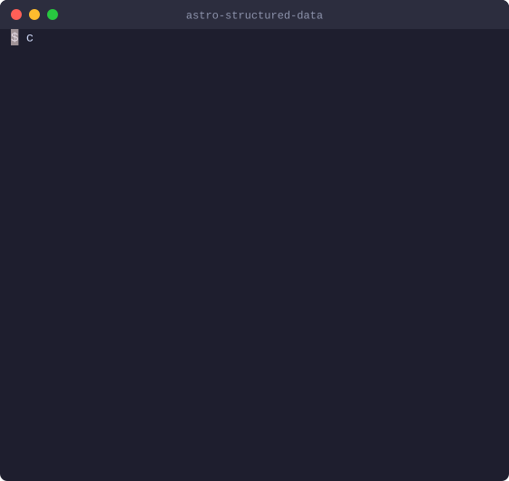

# @casoon/astro-structured-data

Structured data for Astro, from the content you already have.

Search engines read [schema.org](https://schema.org) JSON-LD to understand a page and to show it as a rich result: an article with its date and image, a product with price and stock, an event with its date and venue, a job with salary and location. This integration turns your page data into that JSON-LD and the matching meta tags, and stops the build when the data would not be valid.

[](https://www.npmjs.com/package/@casoon/astro-structured-data)
[](https://astro.build/)
[](LICENSE)

**Website and documentation:** [casoon.github.io/astro-structured-data](https://casoon.github.io/astro-structured-data/) · [npm](https://www.npmjs.com/package/@casoon/astro-structured-data)

<p align="center">
  
</p>
<p align="center"><sub>Recorded from real builds of the sample project in <a href="site/captures/"><code>site/captures/</code></a>.</sub></p>

## Why

- **Rich results need structured data.** Prices, ratings, event dates or job details only appear in search results when the page describes them as schema.org data.
- **Hand-written JSON-LD fails silently.** A wrong date format or a missing required field produces no error; the markup is simply not used.
- **Your pages already have the data.** Pass frontmatter, content collection or CMS fields as props instead of keeping a second copy as JSON.
- **Checked where you can fix it.** Wrong data stops the build with the component, the page and the field. No client JavaScript is added.

## Install

```bash
npm install @casoon/astro-structured-data
pnpm add @casoon/astro-structured-data
yarn add @casoon/astro-structured-data
```

```js
// astro.config.mjs
import { defineConfig } from 'astro/config';
import structuredData from '@casoon/astro-structured-data';

export default defineConfig({
  site: 'https://example.com', // or pass siteUrl to the integration
  integrations: [
    structuredData({
      generateMeta: true,
      siteName: 'Example Blog',
      locale: 'en_US',
    }),
  ],
});
```

All options: [Integration options](https://casoon.github.io/astro-structured-data/docs/reference/options/).

## Quick start

```astro
---
// src/layouts/Post.astro
import { ArticleSchema } from '@casoon/astro-structured-data/components';
const { post } = Astro.props;
---
<ArticleSchema
  title={post.data.title}
  description={post.data.description}
  datePublished={post.data.date}
  authorName={post.data.author}
  imageUrl={post.data.cover}
/>
```

Run `astro build`: the page gets a `BlogPosting` JSON-LD block and, with `generateMeta`, the canonical, Open Graph and Twitter tags. Wrong data stops the build, missing recommended fields are listed. Walkthrough: [Quickstart](https://casoon.github.io/astro-structured-data/docs/getting-started/quickstart/) · setups for blogs, shops, local businesses, events and job boards: [Setups by kind of site](https://casoon.github.io/astro-structured-data/docs/guides/site-setups/).

## Components

Imported from `@casoon/astro-structured-data/components`. Each page has an example, the JSON-LD it produces, every prop and the rules it checks.

| Component | Purpose |
|---|---|
| [`ArticleSchema`](https://casoon.github.io/astro-structured-data/docs/components/article/) | Blog posts, news and articles (`BlogPosting`, `Article`, `NewsArticle`) |
| [`FAQSchema`](https://casoon.github.io/astro-structured-data/docs/components/faq/) | Question and answer pages (`FAQPage`) |
| [`ProductSchema`](https://casoon.github.io/astro-structured-data/docs/components/product/) | Products with offers, ratings, shipping and returns |
| [`LocalBusinessSchema`](https://casoon.github.io/astro-structured-data/docs/components/local-business/) | Address, phone and opening hours of a business |
| [`EventSchema`](https://casoon.github.io/astro-structured-data/docs/components/event/) | On-site, online and hybrid events |
| [`OrganizationSchema`](https://casoon.github.io/astro-structured-data/docs/components/organization/) | The organization behind the site |
| [`WebSiteSchema`](https://casoon.github.io/astro-structured-data/docs/components/website/) | The site itself, optionally with a site search action |
| [`WebPageSchema`](https://casoon.github.io/astro-structured-data/docs/components/webpage/) | Generic pages, plus `robots` and `hreflang` alternates |
| [`ProfilePageSchema`](https://casoon.github.io/astro-structured-data/docs/components/profile-page/) | Author and person profiles |
| [`CollectionPageSchema`](https://casoon.github.io/astro-structured-data/docs/components/collection-page/) | Category, listing and archive pages |
| [`JobPostingSchema`](https://casoon.github.io/astro-structured-data/docs/components/job-posting/) | On-site, remote and hybrid job postings |
| [`SoftwareAppSchema`](https://casoon.github.io/astro-structured-data/docs/components/software-app/) | Apps with price, rating, OS and category |
| [`RecipeSchema`](https://casoon.github.io/astro-structured-data/docs/components/recipe/) | Recipes with ingredients, steps and times |
| [`VideoSchema`](https://casoon.github.io/astro-structured-data/docs/components/video/) | Videos (`VideoObject`) |
| [`BreadcrumbSchema`, `AutoBreadcrumbSchema`](https://casoon.github.io/astro-structured-data/docs/components/breadcrumbs/) | Breadcrumb trails, given or built from the URL path |
| [`Schema`, `SchemaGraph`](https://casoon.github.io/astro-structured-data/docs/components/schema/) | Any other schema.org type; the position of the page's `@graph` block |

Zod schemas for every component, `validateRecommended` and `calculateReadingTime`: [Zod schemas and content](https://casoon.github.io/astro-structured-data/docs/guides/content-collections/) · [Package exports](https://casoon.github.io/astro-structured-data/docs/reference/api/).

## Features

- **[Validation](https://casoon.github.io/astro-structured-data/docs/guides/validation/):** props are checked against Zod schemas at render time (ISO formats, cross-field rules, schema.org objects, unknown props); invalid data fails the build or, in SSR, the request.
- **[Meta tags and sitemap hints](https://casoon.github.io/astro-structured-data/docs/guides/meta-tags/):** with `generateMeta: true`, canonical, Open Graph and Twitter tags come from the most page-specific schema; tags your layout sets win. `changefreq` and `priority` are passed to post-build sitemap generators.
- **[Graph mode](https://casoon.github.io/astro-structured-data/docs/guides/graph-mode/):** with `useGraph: true`, all schemas of a page are merged into one `@graph` block, linked by `@id`.
- **[Dev Toolbar](https://casoon.github.io/astro-structured-data/docs/guides/dev-toolbar/):** in `astro dev`, a panel previews each schema of the page as a rich result and lists missing fields.
- **[Build check](https://casoon.github.io/astro-structured-data/docs/guides/dev-toolbar/#the-build-report):** after `astro build`, every JSON-LD block is parsed and missing recommended fields are listed per type.
- **[On-demand rendering](https://casoon.github.io/astro-structured-data/docs/guides/on-demand-rendering/):** works the same with an adapter; how streaming and errors behave there.

## Compatibility

| Package version | Astro | Node.js |
|---|---|---|
| **2.4.x** | 5.x · 6.x · 7.x | ≥ 18 |
| 2.1.x – 2.3.x | 5.x · 6.x · 7.x | ≥ 18 |
| 2.0.x | 5.x · 6.x · 7.x | ≥ 18 |
| 1.5.x | 5.x · 6.x · 7.x | ≥ 18 |
| 1.4.x | 5.x · 6.x | ≥ 18 |

The Node.js minimum is the one of your Astro version (its `engines` field): Astro 5 needs 18.20.8, 20.3 or 22+, Astro 6 needs 22.12+, Astro 7.4 needs 22.23.4+.

Astro 5 and 6 are checked locally with `npm run test:compat` (see Development); last verified with Astro 5.18.2 and 6.4.8 on Node 22.12 and 24.

Coming from 1.x: see the [upgrade guide](https://casoon.github.io/astro-structured-data/docs/guides/upgrading/). All changes are listed in the [changelog](CHANGELOG.md).

## Development

```bash
npm test              # unit tests and end-to-end tests (real static build, dev server and Node SSR)
npm run test:compat   # the same suite against Astro 5 and Astro 6
npm run check         # type-check, including the .astro components
npm run build
```

`npm run test:compat -- 6` checks one major only; it needs network access and Node 22.12+. Details: [How compatibility is checked](https://casoon.github.io/astro-structured-data/docs/getting-started/installation/#how-compatibility-is-checked).

## License

MIT
